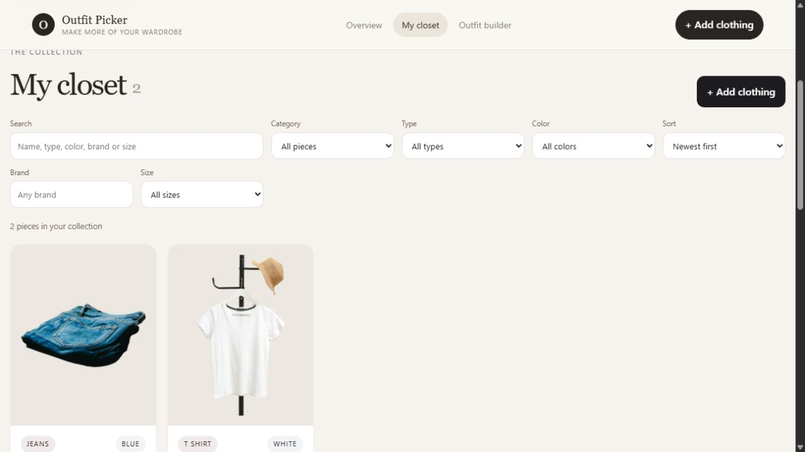
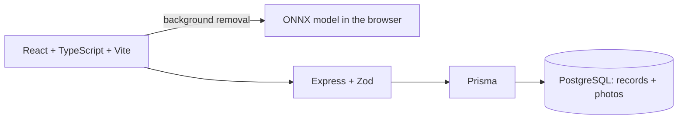
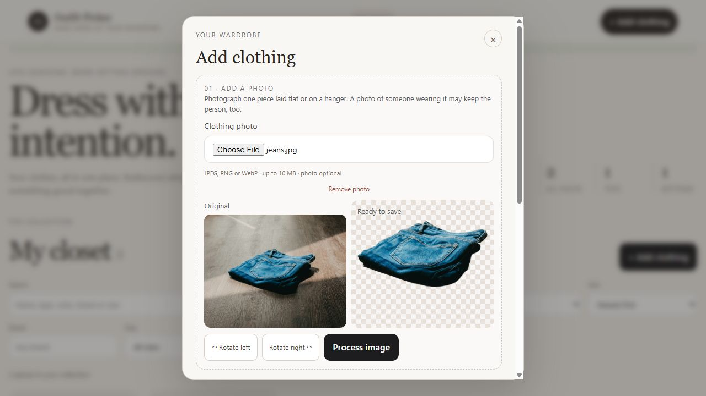
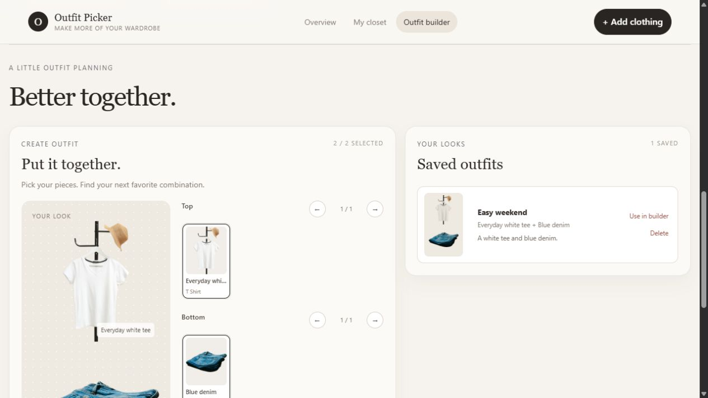
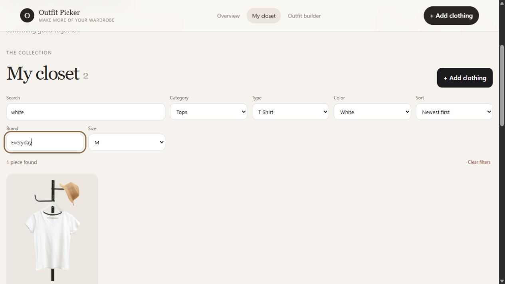
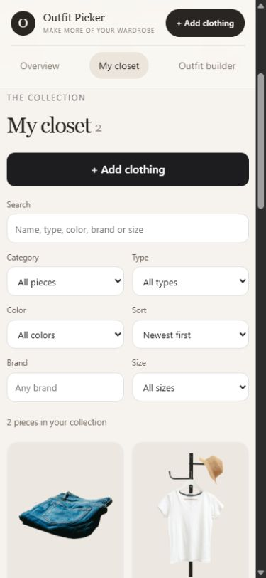

# Outfit Picker

A digital closet for the clothes you already own. Upload a top or bottom, remove its photo background right in the browser, keep track of its details, and put together outfits you can save for later.

**Live demo:** _add your Render URL here after deploying_. The demo wardrobe is shared by every visitor and resets to sample clothes once a day.



## What works

- Create, browse, edit, and delete clothing with name, category, type, color, brand, size, and notes.
- Upload JPEG, PNG, or WebP photos, rotate them, remove the background on your own device, and review the transparent result before saving.
- Search name, brand, notes, size, color, category, and clothing type. Combine category, type, color, brand, and size filters; sort by name or date.
- Pick a top and bottom using thumbnails or previous/next arrows. See a stacked preview and save a named outfit.
- View and delete saved outfits with their actual clothing photos. Load a saved look into the builder to make another combination.
- Use keyboard-accessible cards and dialogs, responsive layouts, loading feedback, and recoverable error messages.

## Architecture



In production a single Express service serves the API, the stored photos, and the built React app, so everything shares one origin.

- **Background removal** runs in the visitor's browser with [`@imgly/background-removal`](https://github.com/imgly/background-removal-js) (ISNet model on ONNX Runtime Web). The model, about 40 MB, downloads from IMG.LY's CDN on first use and is cached by the browser. No server GPU or Python runtime is needed, and original photos never leave the device.
- **The API** validates requests with Zod and checks that every uploaded photo really is a PNG of a reasonable size before storing it.
- **Photos are stored in Postgres** (`StoredImage` table) and served at `/uploads/<uuid>.png` with long-lived cache headers. Keeping them in the database means the app needs only a database, not a separate file store.
- Outfits reference real clothing rows through `OutfitItem`, with a top and bottom role. Deleting clothing removes every outfit that uses it in one transaction. Changing the category of an item used by an outfit is rejected until those outfits are removed.

### Public demo safeguards

The deployed demo has no accounts, so these settings keep it from being abused (see `render.yaml`):

- `DEMO_RESET_HOURS=24`: the database is restored to the sample wardrobe (`backend/prisma/demo-images`) when the last reset is more than a day old. Free hosts sleep between visits, so the check runs on incoming requests rather than on a timer.
- `MAX_CLOTHING_ITEMS`, `MAX_OUTFITS`, `MAX_STORED_IMAGES`: caps on how much the shared database can hold.
- `WRITE_RATE_LIMIT`: changes allowed per visitor IP every 15 minutes.

## Deploy for free (Render + Neon)

1. **Database:** create a free project at [neon.tech](https://neon.tech). Copy the connection string from its dashboard (`postgresql://…?sslmode=require`).
2. **Web service:** on [render.com](https://render.com), choose **New → Blueprint** and select this repository. Render reads `render.yaml` and creates one free web service.
3. When Render asks for `DATABASE_URL`, paste the Neon connection string and apply.
4. The first deploy builds the frontend and API, applies the database migrations, and loads the sample wardrobe on the first visit. Your site will be at `https://outfit-picker-XXXX.onrender.com`.

Every push to the main branch redeploys automatically.

**About the free tier:** Render puts free services to sleep after 15 minutes without traffic. The next visit wakes the service, which takes about a minute. If you want it to answer instantly, a free uptime monitor (for example [UptimeRobot](https://uptimerobot.com)) that requests `/api/health` every 10 minutes keeps it awake. One service running all month stays within Render's free hours.

## Run locally

Requires Node.js 22+ and PostgreSQL 14+. Commands run from the `Outfit-Picker` folder.

```bash
npm ci --prefix frontend
npm ci --prefix backend
cp backend/.env.example backend/.env   # then edit the two database URLs
npm --prefix backend run db:setup      # applies migrations, generates Prisma Client
npm --prefix backend run seed:demo     # optional: REPLACES all data with the sample wardrobe
```

Start the API and the frontend in two terminals:

```bash
npm --prefix backend run dev
npm --prefix frontend run dev
```

Open [localhost:5173](http://localhost:5173). The API runs on port 4000.

To try the production setup locally, run `npm run build` and then `STATIC_DIRECTORY=../frontend/dist npm start` from the `Outfit-Picker` folder, and open [localhost:4000](http://localhost:4000).

After schema changes, create a migration with `npm --prefix backend run db:migrate`.

## Image processing and its limits

ISNet separates foreground from background. **It is not a clothing-specific parser.** A photo of a person wearing a shirt can keep the person, and nearby objects or a hanger may remain. For best results, photograph one piece laid flat against a contrasting background, and review the preview before saving.

The browser applies camera orientation, resizes large photos to a maximum edge of 1600 pixels, removes the background, trims transparent margins, and scales the result to at most 1200 pixels. The API accepts PNGs up to 4 MB and 2048 pixels per side. Processing takes a few seconds on a laptop and longer on older phones. The first run also downloads the model.

Previews that are never saved are removed once they are a day old, either when photo storage fills up or with:

```bash
npm --prefix backend run cleanup:uploads
```

## Configuration

Backend settings go in `backend/.env` locally (see `.env.example`) and in `render.yaml` for production.

| Variable | Default | Purpose |
| --- | --- | --- |
| `DATABASE_URL` | none | Postgres connection string |
| `TEST_DATABASE_URL` | none | Separate database for `npm test`; tests delete its rows |
| `HOST` / `PORT` | `127.0.0.1` / `4000` | API bind address and port (`0.0.0.0` in production) |
| `CLIENT_URL` | `http://localhost:5173` | Allowed browser origin for local development |
| `STATIC_DIRECTORY` | unset | Serve the built frontend from this folder |
| `DEMO_RESET_HOURS` | `0` (off) | Restore the sample wardrobe every N hours |
| `MAX_CLOTHING_ITEMS` / `MAX_OUTFITS` / `MAX_STORED_IMAGES` | `500` / `500` / `1000` | Storage caps |
| `WRITE_RATE_LIMIT` | `0` (off) | Write requests per IP per 15 minutes |
| `TRUST_PROXY` | `0` | Proxies in front of the app (`1` on Render), so rate limits see real IPs |
| `VITE_API_BASE_URL` | `http://localhost:4000/api` in dev, `/api` in builds | Frontend API URL |
| `VITE_BACKGROUND_MODEL_URL` | IMG.LY CDN | Optional self-hosted model location |

## API

| Method | Route | Behavior |
| --- | --- | --- |
| GET | `/api/health` | API health and demo settings |
| GET / POST | `/api/clothing` | List/filter or create clothing |
| GET / PATCH / DELETE | `/api/clothing/:id` | Read, edit, or remove a piece |
| GET / POST | `/api/outfits` | List or create saved outfits |
| GET / PATCH / DELETE | `/api/outfits/:id` | Read, edit, or remove an outfit |
| POST | `/api/images` | Multipart `file` (PNG with background removed); returns `{ imageUrl }` |
| DELETE | `/api/images/:filename` | Discard a processed photo only if unused |
| GET | `/uploads/:filename` | Serve a saved photo |

Clothing filters are `search`, `category`, `type`, `color`, `brand`, `size`, and `sort`. Text search is case-insensitive. Enum values use uppercase strings such as `TOP`, `T_SHIRT`, and `WHITE`. Sorting accepts `newest`, `oldest`, `name-asc`, and `name-desc`. Outfits require a name, `topClothingItemId`, and `bottomClothingItemId`; description is optional. Invalid requests receive JSON errors with HTTP 400, missing records 404, conflicting category changes 409, and full storage 403.

## Verification

```bash
npm --prefix backend test      # needs TEST_DATABASE_URL
npm --prefix backend run build
npm --prefix frontend run lint
npm --prefix frontend run build
```

See [validation notes](Outfit-Picker/docs/VALIDATION.md) for what was checked and how.

## Screenshots






[Full app screenshot](Outfit-Picker/docs/screenshots/full-app.jpg)

These screenshots were taken with the earlier server-side BiRefNet version. Photo credits: [Mediamodifier — white tee](https://unsplash.com/photos/white-crew-neck-t-shirt-hanged-on-black-clothes-hanger-TvL5vIgwiwo) and [Dylan Ferreira — jeans](https://unsplash.com/photos/blue-textile-on-brown-wooden-table-cOmWMVeLLzA), from Unsplash.

## History

The first version ran background removal on the server with [BiRefNet](https://huggingface.co/ZhengPeng7/BiRefNet) in a FastAPI + PyTorch service, with SQLite and photos on local disk. That needed several GB of RAM, which free hosting can't provide, so removal moved into the browser and storage moved to Postgres. The Python service is still in this repository's git history.

## License note

`@imgly/background-removal` is licensed under the AGPL-3.0. This project's source is public, which satisfies that license's requirement to make the source of a network-served app available.
